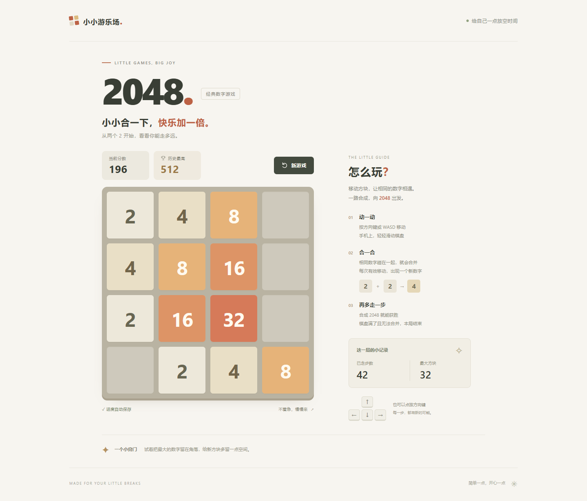

# 2048 · 小小合一下

一个中文网页版 2048。支持电脑键盘、手机滑动、方向按钮、自动续玩与历史最高分。

使用 HTML、CSS、原生 JavaScript 和 Vite 实现，无后端服务和外部字体依赖。规则与界面独立，适合学习和继续改造。



## 在你的电脑上开始

环境已验证：Windows、Node.js 24.19.0、npm 11.17.0、Git 2.55.0。项目要求 Node.js 22.12 或更新版本，建议使用 Node.js 24 LTS。

在 PowerShell 中打开项目目录：

```powershell
cd 'G:\CodexProjects\codex开发小游戏'
npm.cmd ci
npm.cmd run dev
```

首次安装或重新下载项目时运行 `npm.cmd ci`。依赖已安装时只需运行 `npm.cmd run dev`。

打开终端显示的网址，通常为 http://127.0.0.1:5173 。端口占用时 Vite 会选择后续端口，以终端输出为准。停止服务按 `Ctrl+C`。

PowerShell 示例使用 `npm.cmd`，不需要修改系统的脚本执行策略。其他终端也可以使用 `npm`。npm 缓存位于本项目的 `.npm-cache`，不需要更改系统目录权限。

## 操作与规则

- 电脑：方向键或 WASD；也可拖动棋盘或点击方向按钮。
- 手机：在棋盘上向上、下、左、右滑动；页面其他区域可以正常滚动。
- 4×4 棋盘，开局生成两个数字。有效移动后随机出现一个 2（90%）或 4（10%），位置从空格中等概率选择。
- 相同数字从移动方向的前端开始合并，新合成的方块在这一步不会再次合并；分数增加合成后的数字。
- 无效移动不生成新数字、不加分、不计步。
- 首次合成 2048 提示获胜，可以继续挑战。没有空位且无法合并时结束。
- 点击“新游戏”立即重新开始，保留历史最高分。

游戏保存在当前浏览器、当前网址的 localStorage 中。刷新可以续玩；浏览器之间、不同端口或不同网址之间不会同步。清理网站数据会清除存档和最高分。存储被禁用或空间不足时会提示，游戏仍然可玩。

## 理解代码

```text
index.html                 页面结构与中文文案
src/
  game.js                  纯规则：移动、合并、生成、计分、胜负
  storage.js               存档结构验证、保存、读取和失败回退
  main.js                  输入、动画、页面更新与游戏生命周期
  style.css                暖色界面、手机与笔记本适配、减少动态效果
tests/                     规则与存档单元测试
e2e/game.spec.js            真实浏览器交互测试
scripts/capture-preview.mjs 生成可复现的示例截图
docs/                      设计、开发方案、预览截图
public/favicon.svg         本地站点图标
```

一次移动的数据流：

```text
键盘 / 滑动 / 按钮
    → playTurn(state, direction)
    → moveBoard：计算四向移动、合并、得分和位移记录
    → 有效移动时 spawnTile：生成一个新数字
    → 保存新状态 → 展示位移动画 → 更新棋盘与分数
    → getStatus：判断是否显示获胜或结束提示
```

`moveBoard` 不修改输入，不生成随机数字，也不访问浏览器。`playTurn` 和 `spawnTile` 的随机源可以注入，便于用固定输入验证结果。移动动画期间锁定重复输入；重新开始会取消旧动画的最终更新，防止画面回到上一局。

存档格式为 `{ version: 1, state: { board, score, moves, continued }, best }`。非法棋盘、全空棋盘、错误的数字或标记会回退到新游戏，并尽可能保留有效的最高分。

## 测试与构建

```powershell
npm.cmd test
npm.cmd run test:e2e
npm.cmd run build
npm.cmd run preview
```

- 单元测试使用 Node 内置的 `node:test`，覆盖四向合并、输入不变、单次不可重复合并、随机阈值、无效移动、胜负与存档容错。
- 浏览器测试使用 Playwright，默认运行已安装的 Microsoft Edge，分别检查桌面与手机环境。包含真实触摸事件、快速按键、刷新、重新开始、胜负提示、320px 窄屏、减少动态效果和笔记本棋盘可见性。
- 测试会自动启动本地开发服务；已有同端口服务时会复用。测试存档只写入独立测试浏览器，不影响你日常浏览器的进度。
- 打包结果在 `dist/`，使用相对资源路径，可以部署到静态站点的子目录。用 `npm.cmd run preview` 检查打包后的版本；应通过 HTTP 服务访问，而不是双击 `dist/index.html`。

浏览器截图可在开发服务启动后生成：

```powershell
node scripts/capture-preview.mjs
```

这会生成桌面、笔记本、手机三种示例截图。脚本在临时浏览器上下文中放入固定棋盘，不改变你的游玩存档。

## Git 与后续扩展

已忽略依赖目录、构建输出、npm 缓存和测试报告。提交 `package-lock.json`，以便在其他电脑上复现依赖。

建议后续每次创建一个分支，只增加一个功能，例如撤销一步、主题切换或新棋盘尺寸，再完成测试和提交。当前版本不需要 GitHub 账号即可本地游玩；上传仓库与发布在线版本可以独立进行。

本项目的页面、样式和规则代码独立实现，未复制原版 2048 源代码或素材。玩法参考经典 2048。
