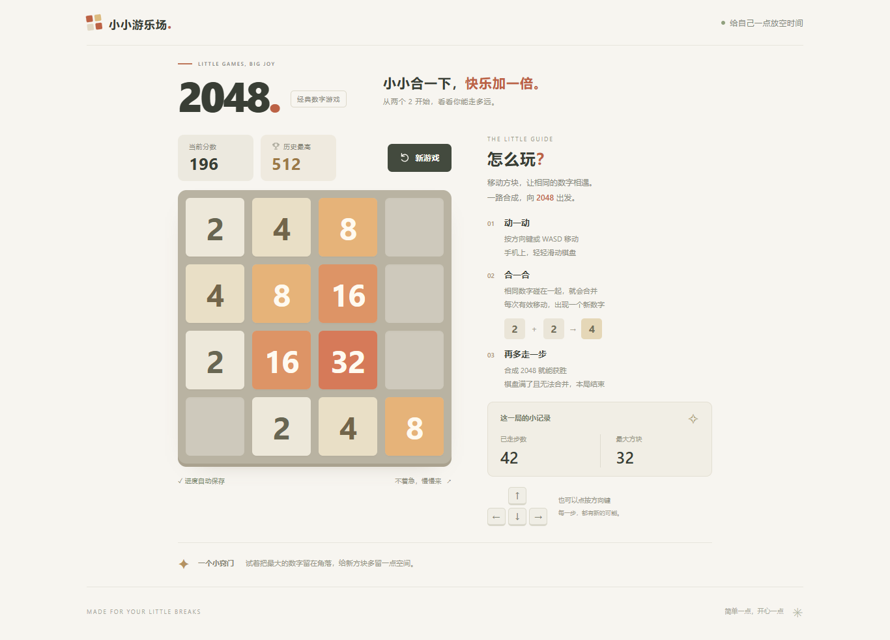

# 2048 · 小小合一下

[](https://github.com/Uerr-lovelife/2048-little-moments/actions/workflows/ci.yml)

一个中文网页版 2048。使用 HTML、CSS、原生 JavaScript 和 Vite，支持电脑键盘、手机滑动、方向按钮、自动续玩及最高分记录。

规则、存档和界面分开组织，便于学习、修改和移植；无需后端、数据库或在线字体服务。



## 快速开始

需要 Node.js 22.12 或更新版本，推荐 Node.js 24 LTS。安装 Git 后运行：

```bash
git clone https://github.com/Uerr-lovelife/2048-little-moments.git
cd 2048-little-moments
npm ci
npm run dev
```

打开终端显示的本地网址。以后只需 `npm run dev`；依赖变化时重新执行 `npm ci`。停止服务按 `Ctrl+C`。

Windows PowerShell 若阻止 `npm.ps1`，改用 `npm.cmd ci`、`npm.cmd run dev`，不用修改系统执行策略。

## 怎么玩

- 方向键、WASD、棋盘滑动或屏幕方向按钮控制移动。
- 相同数字按移动方向合并，每个方块每步最多参与一次合并。
- 有效移动后随机生成 2（90%）或 4（10%）；无效移动不生成、不加分、不计步。
- 合成 2048 获胜，可以继续挑战。棋盘没有空位且无法合并时结束。
- 点击“新游戏”立即重新开始，并保留当前浏览器的历史最高分。
- 自动保存当前棋盘和分数；存储不可用时仍能游玩。存档不会在不同浏览器、网址或设备间同步。

## 项目结构

```text
.github/                    CI、问题模板、PR 模板
src/
  game.js                   纯规则：移动、合并、生成、胜负
  storage.js                存档验证与失败回退
  main.js                   输入、渲染、动画、游戏生命周期
  style.css                 暖色主题、响应式布局、动态效果
public/                     原样复制到构建产物的静态资源
scripts/                    截图等维护工具
tests/                      规则与存档单元测试
e2e/                        桌面与手机浏览器交互测试
docs/
  architecture.md           接口、数据流与扩展位置
  development.md            环境、测试、截图与排查
  deployment.md             静态部署、局域网试玩和移植
  images/                   电脑、笔记本、手机截图
  history/                  初版设计与开发记录
index.html                  页面入口与中文文案
package.json                命令、运行环境与开发依赖
package-lock.json           锁定依赖版本
CONTRIBUTING.md             分支、提交、PR 与维护约定
CHANGELOG.md                版本变更记录
```

`dist/`、`node_modules/`、缓存和测试结果均不入库。`src/game.js` 不依赖浏览器，可以单独测试并复用。

## 验证与构建

| 命令 | 用途 |
| --- | --- |
| `npm test` | 规则、计分、随机生成和存档测试 |
| `npm run test:e2e` | 键盘、触摸、续玩、胜负、窄屏与动画交互测试 |
| `npm run build` | 输出可部署的静态文件到 `dist/` |
| `npm run preview` | 在本机检查打包后的游戏 |

Windows 测试默认使用已安装的 Edge。Linux / macOS 首次运行浏览器测试前执行 `npx playwright install chromium`。其他浏览器选项见[开发说明](docs/development.md)。

GitHub Actions 会在 Windows 和 Ubuntu 执行单元测试与构建，在 Ubuntu 执行 Chromium 的桌面、手机交互测试。成功后可在对应运行中下载 `2048-static-site` 构建附件。

## 修改、移植和发布

- [架构说明](docs/architecture.md)：从哪里改规则、存档和界面。
- [开发说明](docs/development.md)：完整环境与测试方法。
- [部署与移植](docs/deployment.md)：复制到其他电脑、静态托管、手机局域网试玩。
- [贡献与维护约定](CONTRIBUTING.md)：分支、提交和 PR 流程。
- [变更记录](CHANGELOG.md)：版本功能与工程变更。

上传仓库后仍需另行部署，才能获得手机随时可用的在线游戏网址。当前 CI 不会自动启用 GitHub Pages。

## 许可与来源

页面、样式与规则代码独立实现，玩法参考经典 2048，未复制原版源码或素材。按仓库所有者选择，当前暂不添加开源许可证；公开可查看不代表已授予开源复用许可。
